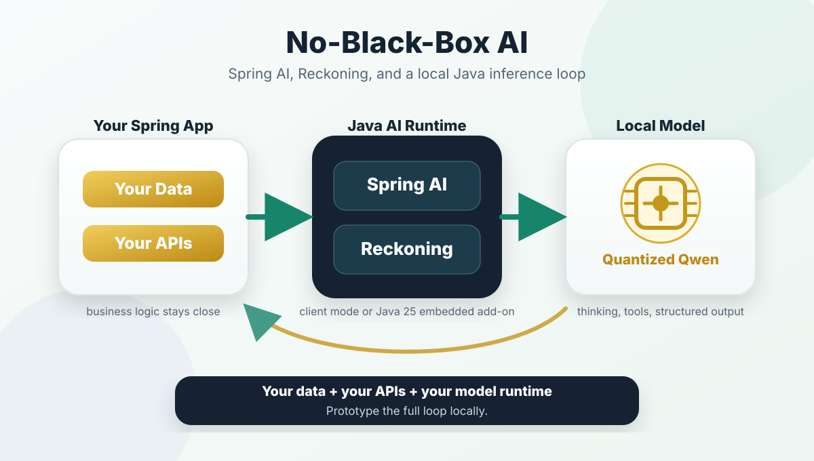

# Spring AI Reckoning

Spring AI Reckoning provides a native Spring AI `ChatModel` integration for [Reckoning](https://github.com/edwardcapriolo/reckoning), a Java inference engine that can download, load, and serve local models or connect to an existing Reckoning server. It keeps the Spring AI application model while using Reckoning's OpenAI-compatible chat, streaming, tool-calling, model discovery, fetch, and serve APIs.

## Pull Request Review Demo

The `spring-ai-reckoning-demo` module is a small Spring Boot application that uses the Reckoning `ChatModel` to review pull requests. It sends a diff to the model and returns structured findings, making the integration concrete without hiding the Spring AI programming model.

## No-Black-Box Java AI

The integration keeps the model boundary visible: Spring AI applications can use Reckoning through the client API, while the embedded module exposes direct in-process inference when Java 25 is acceptable.



See the full explanation in [No-black-box Java AI](spring-ai-reckoning/no_black_box_java_ai.md).

## Getting Started

Qwen3 0.6B JQ4 is a good first model because it is small enough for a quick local setup while still demonstrating chat, streaming, and tool-oriented workflows. Reckoning identifies it as `edwardcapriolo/Qwen3-0.6B-JQ4`.

Start a Reckoning server, then fetch and serve the model:

```bash
curl -X POST http://localhost:8080/api/fetch \
  -H 'Content-Type: application/json' \
  -d '{"owner":"edwardcapriolo","name":"Qwen3-0.6B-JQ4"}'

curl -X POST http://localhost:8080/api/serve \
  -H 'Content-Type: application/json' \
  -d '{"owner":"edwardcapriolo","name":"Qwen3-0.6B-JQ4","type":"GENERATION"}'
```

Reckoning stores models in its local cache (`~/.reckoning`, with support for the legacy `~/.deliverance` cache). A Docker run can reuse that cache:

```bash
docker run --rm -p 8080:8080 \
  -v "$HOME/.reckoning:/home/reckoning/.reckoning:rw" \
  -v "$HOME/.deliverance:/home/reckoning/.deliverance:ro" \
  ecapriolo/reckoning:0.0.17
```

Configure a Spring AI application with:

```properties
spring.ai.reckoning.base-url=http://localhost:8080
spring.ai.reckoning.mode=client
spring.ai.reckoning.model=Qwen3-0.6B-JQ4
```

## Build

The root project builds four modules: the generated Spring WebClient, the Spring AI model integration, the Java 25 embedded integration, and the Java 17 demo application.

```bash
mvn clean install
```

The Docker integration test is opt-in because it downloads or loads a model:

```bash
RECKONING_RUN_DOCKER_IT=true mvn -pl spring-ai-reckoning -am \
  -Dtest=ReckoningDockerChatIT test
```

## Modules

- `client-spring`: Java 17 generated client for Reckoning's HTTP API.
- `spring-ai-reckoning`: Java 17 Spring AI `ChatModel` integration.
- `spring-ai-reckoning-embedded`: Java 25 integration for in-process Reckoning inference.
- `spring-ai-reckoning-demo`: Java 17 pull-request review demo.

## References

- [Reckoning](https://github.com/edwardcapriolo/reckoning)
- [Reckoning documentation](https://github.com/edwardcapriolo/reckoning/tree/main/core)
